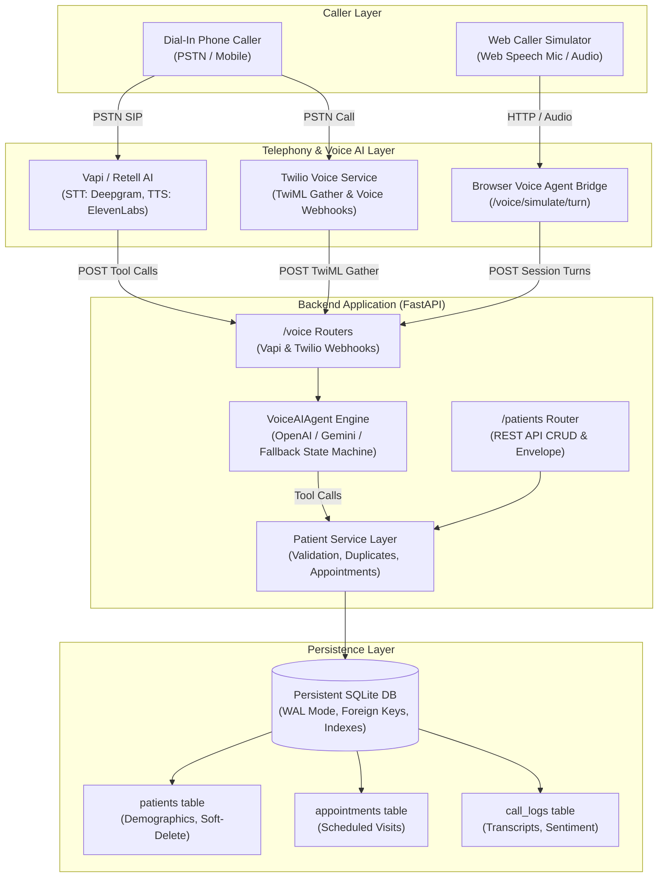
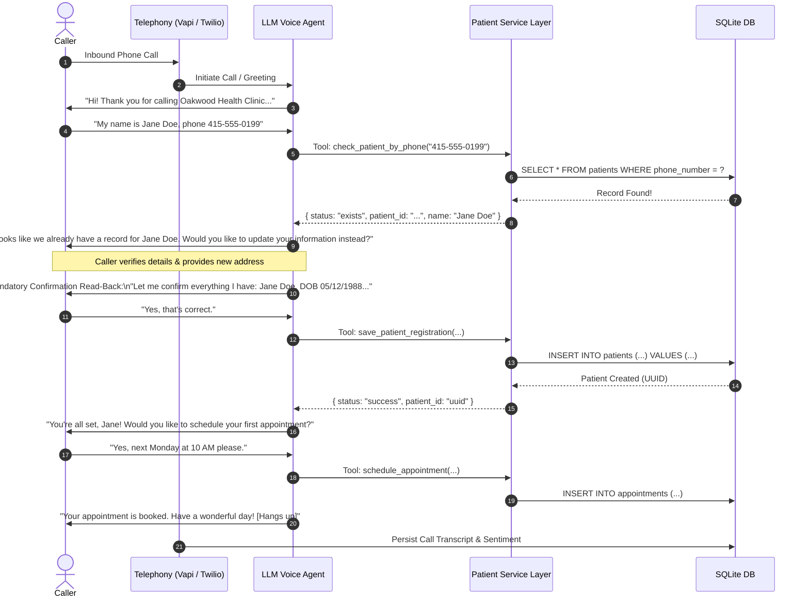

# System Architecture: Voice AI Patient Registration System

This document outlines the architectural design, separation of concerns, data pipelines, and error resilience strategies implemented for the Voice AI Patient Registration System at Oakwood Health Clinic.

---

## 1. High-Level Architecture Diagram



---

## 2. Separation of Concerns

The codebase follows a clean, modular tiered architecture:

| Layer | Directory / Module | Responsibility |
| :--- | :--- | :--- |
| **API Routers** | `app/routers/` | Exposes REST endpoints (`/patients`, `/voice/vapi`, `/voice/twilio`, `/voice/simulate`), validates request payloads, and formats uniform response envelopes. |
| **Service Layer** | `app/services/` | Contains core domain logic: caller duplicate detection, dynamic field normalization, appointment scheduling, and LLM prompt execution. |
| **LLM Agent** | `app/services/llm_agent.py` | Manages conversational state, prompt guidelines, confirmation read-backs, error re-prompting, multi-language switching, and function calling. |
| **Data Repositories** | `app/repositories/` | Direct database transactions, SQL parameterized queries, index usage, and soft-delete enforcement. |
| **Data Models** | `app/models/` | Strict Pydantic schemas enforcing standard U.S. patient demographic validation rules and consistent envelope structures. |
| **Database** | `app/database.py` | Connection pooling, SQLite WAL journal mode, automatic migrations, foreign key enforcement. |

---

## 3. End-to-End Call Sequence Flow



---

## 4. Database Schema & Data Integrity

The SQLite database enforces referential integrity with `PRAGMA foreign_keys = ON;` and concurrency with `PRAGMA journal_mode = WAL;`.

### Patients Table (`patients`)
```sql
CREATE TABLE patients (
    patient_id TEXT PRIMARY KEY,
    first_name TEXT NOT NULL,
    last_name TEXT NOT NULL,
    date_of_birth TEXT NOT NULL,
    sex TEXT NOT NULL,
    phone_number TEXT NOT NULL,
    email TEXT,
    address_line_1 TEXT NOT NULL,
    address_line_2 TEXT,
    city TEXT NOT NULL,
    state TEXT NOT NULL,
    zip_code TEXT NOT NULL,
    insurance_provider TEXT,
    insurance_member_id TEXT,
    preferred_language TEXT DEFAULT 'English',
    emergency_contact_name TEXT,
    emergency_contact_phone TEXT,
    created_at TEXT NOT NULL,
    updated_at TEXT NOT NULL,
    deleted_at TEXT DEFAULT NULL
);
```

### Soft-Delete Pattern
Records are never permanently dropped from the database when `DELETE /patients/:id` is invoked. Instead, `deleted_at` is set to the current UTC timestamp. All `GET /patients` and `GET /patients/:id` queries filter `WHERE deleted_at IS NULL`.
